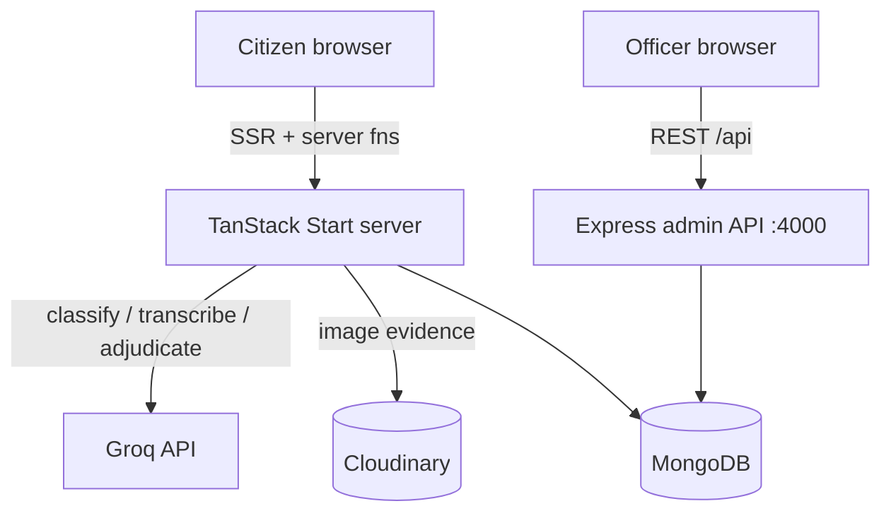

# SamadhanSetu (समाधान सेतु)

**SamadhanSetu Citizens** is an AI-assisted citizen grievance redressal platform for Indian government services. It lets citizens file civic complaints in English or Hindi — by typing or by voice — and uses a large language model to classify each grievance, route it to the correct department, assess its priority, and flag likely duplicates, while keeping every automated decision auditable and reviewable by a human.

## Project Overview

Citizens often struggle to get local civic problems to the right government office, and officers struggle to triage large volumes of complaints fairly. SamadhanSetu bridges that gap (the "setu", or bridge, in the name) by turning a free-text or spoken complaint into a structured, routed, prioritised grievance.

The core workflow implemented in the codebase is:

**Citizen complaint → AI classification → department routing → priority & SLA assignment → duplicate detection → officer queue → citizen tracking.**

Target users are citizens filing grievances, department officers working a priority queue, and supervising admins. The platform emphasises transparency, accountability, auditability and privacy of citizen data — classification never fabricates a department; when the model is unavailable, a grievance is saved and marked `PENDING_MANUAL_REVIEW` for a human instead.

## Key Features

- **Citizen registration & login** — mobile + MPIN credentials with PBKDF2 hashing, server-side sessions, generic error messages, login-timing equalisation, and progressive brute-force lockout.
- **Complaint filing (text & voice)** — structured intake with title, description, location (state/district/pincode, optional GPS coordinates), and optional image evidence. Voice complaints are transcribed server-side (Whisper via Groq) with Hindi/English auto-detection.
- **AI classification & routing** — a Groq LLM maps each grievance to one of a closed registry of five departments, with category, priority (Critical/High/Medium/Low), confidence and reasoning. Output is validated against a strict JSON schema and a Zod enum; hallucinated departments are rejected.
- **Working-day SLA assignment** — SLA deadlines are derived from the routed department's configured `slaDays`, skipping weekends.
- **Duplicate detection** — a bounded pipeline (indexed MongoDB filter → local lexical similarity → capped LLM adjudication) flags likely duplicates without ever deleting, merging or blocking a submission. Honest `ANALYSIS_UNAVAILABLE` state when the model can't be reached.
- **Explainability & audit trail** — each decision (classification, priority, transcription, duplicate) is recorded with provider, model, input hash and reasoning, alongside an append-only audit log.
- **Citizen dashboard** — "My Complaints" list scoped strictly to the signed-in citizen.
- **Officer/admin portal** — a separate Express backend serving a department-scoped priority queue and summary counts (P1/P2/P3, unassigned), with role-based access (nodal officer / super admin).
- **Bilingual UI** — English and Hindi locale bundles with an i18n provider.

## Tech Stack

| Area | Technology | Role |
| --- | --- | --- |
| Framework | TanStack Start + TanStack Router | SSR, file-based routing, type-safe server functions |
| UI | React 19, Tailwind CSS v4, Radix UI, Recharts | Components, styling, charts |
| Forms/validation | React Hook Form + Zod | Client and server input validation |
| Primary backend | TanStack Start server functions (Node preset via Nitro) | Auth, grievance intake, AI orchestration |
| Admin backend | Express + Mongoose, JWT, Helmet, CORS, rate-limit | Officer portal ("Roads Test Slice") |
| Database | MongoDB (official driver + Mongoose) | Grievances, citizens, sessions, audit logs |
| AI | Groq API — `openai/gpt-oss-120b` (classification), `whisper-large-v3` (speech) | Classification, prioritisation, duplicate adjudication, transcription |
| Media | Cloudinary, Sharp | Image evidence upload/processing |
| Messaging | Meta WhatsApp Business API | OTP delivery (integration partially wired) |
| Tooling | Vite, TypeScript, ESLint, Prettier | Build and code quality |

## Architecture

SamadhanSetu runs **two backends**. The primary one is TanStack Start server functions (`src/lib/server/*`) handling citizen auth and the AI grievance pipeline. A second, standalone **Express + Mongoose** service (`server/`) powers the officer/admin portal and is consumed by the client at `http://localhost:4000/api`. Both share a single MongoDB cluster; the duplicate/classification code is careful to filter out the Express service's documents, which have a different shape.



Server-only modules carry a `server-only` marker so secrets and DB access can never leak into the client bundle. Sessions use an HttpOnly selector/verifier cookie with a hashed secret stored in MongoDB, so logout revokes access server-side and role is always re-read from the citizen document.

## Getting Started

**Prerequisites:** Node.js and npm (Bun is also supported — a `bun.lock` is present), and a reachable MongoDB instance.

**1. Primary app (citizen platform)**

```sh
git clone <this-repository-url>
cd citizen-samadhan-setu-main
npm install
```

Create `.env.local` in the project root with your own credentials (see `.env.example` for variable names):

```sh
MONGO_URL_SIH=<your-mongodb-connection-string>
GROQ_API_KEY=<your-groq-api-key>
CLOUDINARY_CLOUD_NAME=<...>
CLOUDINARY_API_KEY=<...>
CLOUDINARY_API_SECRET=<...>
# Optional WhatsApp OTP
META_WHATSAPP_TOKEN=<...>
META_PHONE_NUMBER_ID=<...>
META_TEMPLATE_NAME=<...>
```

Then:

```sh
npm run dev          # start the dev server
npm run db:health    # verify MongoDB connectivity (prints coarse status only)
npm run build        # production build
npm run typecheck    # type-check
npm run lint         # lint
```

**2. Admin/officer backend (optional, separate service)**

```sh
cd server
npm install
# create server/.env with MONGO_URL_SIH (and JWT settings)
npm run seed         # seed departments/admins
npm run dev          # Express API on http://localhost:4000
```

## Project Structure

```
citizen-samadhan-setu-main/
├── src/
│   ├── routes/            # File-based routes: index, file-complaint, my-complaints,
│   │                      #   complaint (tracking), login/register, admin.*, officer.login
│   ├── lib/
│   │   ├── server/        # Server-only: auth, session, classification, duplicate,
│   │   │                  #   groq, grievance, evidence, cloudinary, audit, crypto
│   │   ├── validation/    # Zod schemas (complaint, login, registration, duplicate)
│   │   ├── *-api.ts        # Client wrappers (admin-api → Express; complaint/auth → server fns)
│   │   ├── departments.ts # Closed 5-department registry (single source of truth)
│   │   └── mock-data.ts   # Legacy Lovable mock data (older UI pages)
│   ├── i18n/locales/      # en.ts, hi.ts
│   └── components/        # UI components
├── server/                # Standalone Express + Mongoose admin portal
│   └── src/{models,routes,middleware,services,seeds}
├── scripts/db-health.ts   # MongoDB connectivity check
└── vite.config.ts         # Node-server preset (MongoDB needs raw TCP/TLS)
```

## Technical Highlights and Impact

- **Trustworthy AI by construction.** The LLM *recommends*; the application *decides*. Classifier output passes a strict JSON schema, a Zod enum, and a registry re-check; failures retry a bounded number of times and otherwise fall back to manual review. Nothing is guessed.
- **Privacy-preserving duplicate detection.** Candidate projections exclude `citizenId`, description, address and voice metadata, so the adjudicating model never sees citizen PII. Distances are coarsened to 50 m before display.
- **Defence against tampering.** Identity always comes from the HttpOnly session, never request bodies; voice transcripts are re-read from a server-held draft at submit time; roles come from the database.
- **Secret hygiene in code.** Server-only markers, status-code-only error logging, and API keys read exclusively from `process.env` keep credentials out of the client bundle and logs.
- **Civic impact.** Faster, fairer triage; bilingual and voice access for low-literacy users; SLA tracking and an append-only audit trail support accountability and transparency in public service delivery.

## Limitations

- **Two parallel backends.** The Express admin service is explicitly a "Roads Test Slice" and overlaps with the TanStack Start backend; they are not yet unified.
- **Legacy mock data.** `src/lib/mock-data.ts` and some older Lovable-generated pages still use hard-coded sample grievances and are separate from the real AI pipeline.
- **OTP delivery is partial.** The WhatsApp provider is implemented but falls back to a development console provider when unconfigured; there is no production SMS path.
- **Hard-coded admin base URL.** `admin-api.ts` points at `http://localhost:4000`, so the officer portal is not production-configurable without a code change.
- **Closed department set.** Routing is limited to five civic departments; SLA day counts are placeholders to be confirmed against the relevant Citizen's Charter.
- **AI depends on the Groq free tier**, which has returned rate-limit errors under load; the duplicate pipeline is capped specifically to stay within it.
# Samadhan-Setu
